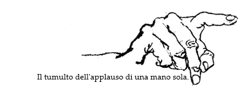

QUARTA EDIZIONE ODD# II/2,xii;68Chs3136

PRINCIPIA DISCORDIA

ovvero

COME TROVAI LA DEA E COSA LE FECI

QUANDO LA TROVAI

essendo questa una introduzione di base ai

Misteri Erisiani

IL CHE E' ESTREMAMENTE INTERESSANTE

-><-

così come divinamente rivelati alla

Mia Alta Reverenza Malaclypse il Giovane, KSC

Onnibenevolente Polipadre della Verginità nell'Oro

e ALTO SACERDOTE dell'

ORDINE PARATEO-ANAMETAMISTICO DELL'ESOTERICA DI ERIS (POEE)

SALVE ERIS! -><- Kallisti -><- TUTTI SALUTINO DISCORDIA!

Dedicato alla più bella

