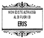
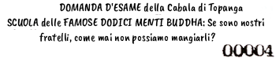

I CINQUE COMANDAMENTI (IL PENTACONATO)

 Il Pentaconato fu scoperto dall'Apostolo eremita Zarathud nel quinto anno del Caterpillar. Egli lo trovò scolpito in una pietra dorata, mentre costruiva un solarium per la sua caverna, ma la sua importanza non fu compresa perché era scritto con una cifratura misteriosa. Tuttavia, dopo 10 settimane e 11 ore di attento esame egli comprese che il messaggio poteva essere letto mettendosi in piedi sulla testa e guardandolo al contrario.

SAPPI QUESTO O UOMO DI FEDE!

I - Non c'è Dea tranne La Dea e Lei è la Tua Dea. Non c'è Movimento Erisiano tranne Il Movimento Erisiano ed esso è Il Movimento Erisiano. E ogni Corpo della Mela D'oro è l'adorata casa di un Verme D'oro

II - Un Discordiano Deve Sempre usare il Sistema Discordiano Ufficiale di Numerazione dei Documenti

III - Si richiede a un Discordiano, nella sua fase iniziale di Illuminazione, che si Allontani in Solitudine e Gioisca della Comunione con un Hot Dog di venerdì; questa Cerimonia Devozionale serve per Protestare contro le numerose forme di Paganesimo di oggi: dei Cattolici Cristiani (niente carne il Venerdì), degli Ebrei (niente carne di Maiale), degli Induisti (niente carne di Manzo), dei Buddisti (niente carne di animali) e dei Discordiani (niente Panini da Hot Dog)

IV - Un Discordiano non mangerà Panini da Hot Dog, poiché Ciò è stato il Conforto della Nostra Dea quando subì l'Affronto Originale

V - È proibito a un Discordiano di Credere a quello che legge

COSI' E' SCRITTO. COSI' SIA. SALVE DISCORDIA!
I PERSECUTORI SARANNO TRASGREDITI.

