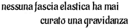

Allora, entrò nella stanza uno scimpanzé, peloso e grigio sul muso, in posizione verticale per tutti i suoi cinque piedi di statura, e in bilico con una maestosità naturale. Portava con se una pergamena e si diresse verso i giovani.

"Signori," disse, "Perché la luna di Pickering gira in orbita inversa? Signori, avete capezzoli sul petto, producono latte? e che cosa, di grazia, signori, si deve fare della legge di Heisenberg?" Fece una pausa. "QUALCUNO DOVEVA METTERE TUTTA QUESTA CONFUSIONE QUI!"

E con ciò svelò la sua pergamena. Era un diagramma, simile a uno yin-yang con un pentagono da una parte e una mela dall'altra. Quindi esplose e i due persero conoscenza.

ERIS - Dea del Caos, Discordia e Confusione

Si svegliarono al frastuono dei birilli e ritrovarono i giocatori di bowling intenti nel loro gioco e la cameriera impegnata a fare il caffè. Era evidente che la loro esperienza era rimasta un fatto privato.

Essi discussero il loro strano incontro e ricostruirono a memoria il diagramma dello scimpanzè. Nei cinque giorni successivi cercarono nelle biblioteche il suo significato ma rimasero delusi trovando solo i riferimenti al taoismo, alla bandiera coreana, e alla tecnocrazia. Fu solo quando identificarono la scritta greca sulla mela che scoprirono l'antica dea conosciuta dai Greci come Eris e dai romani come Discordia. Ciò accadde la quinta notte, e quando si addormentarono, ognuno sognò vividamente una splendida donna i cui occhi erano morbidi come una piuma e profondi come l'eternità stessa, e il cui corpo era una spettacolare danza di atomi e di universi. I suoi capelli fluenti erano pirotecniche di energia pura e arcobaleni si manifestavano e dissolvevano, mentre parlava con una voce calda e gentile:

Sono venuta a dirvi che siete liberi. Molte ere fa, la coscienza di me abbandonò l'uomo affinchè potesse sviluppare se stesso. Torno per trovare questo sviluppo vicino al completamento, ma minacciato da paura e incomprensione.
