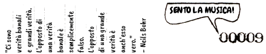

Vi siete costruiti un'armatura sensoriale con cui vi siete rivestiti e la vostra visione è limitata, i vostri movimenti sono goffi e dolorosi, la pelle livida, e il vostro spirito bruciato dal sole.

Io sono il caos. Io sono la sostanza dalla quale i vostri artisti e scienziati costruiscono ritmi. Io sono lo spirito con cui i vostri bambini e clown rideno in un'anarchia felice. Io sono il caos. Io sono viva, e vi dico che siete liberi.

Durante i mesi successivi studiarono filosofia e teologia e appresero che Eris Discordia era sopratutto temuta dagli antichi per il suo carattere devastante. In effetti, il concetto stesso di caos era ancora considerato equivalente a quello di lotta e trattato con una valenza negativa. "Nessuna meraviglia che le cose siano incasinate", conclusero, "hanno capito tutto alla rovescia." Scoprirono che il principio di disordine aveva la stessa significatività del principio d'ordine.

Con questo in mente, studiarono quello strano yin-yang. Mentre meditavano un pomeriggio, una voce si manifestò loro:

E' chiamato il Sacro Cao. Ti nomino tenutario di esso. In esso troverai qualsiasi cosa tu voglia. Chiamami Discordia per manifestare il contrasto al pentagono. Di' all'umanità reclusa che non ci sono regole, a meno che non decidano di inventarsele. Mantieniti vicino alle parole di Syadasti: "è un vento malato che non spazza via le menti". E ricorda che non c'è tirannia nello Stato di Confusione. Per ulteriori informazioni, consulta la tua ghiandola pineale.

