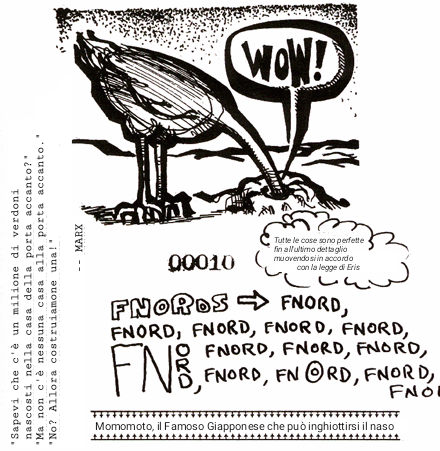

"Cos'è questo?" sussurrò l'uno all'altro, "una religione basata sulla Dea della Confusione? E' follia pura!"

E a quelle parole, ciascuno guardò l'altro in soggezione assoluta. Omar iniziò a ridacchiare. Mal si mise a ridere. Omar iniziò a saltare su e giù. Mal a ululare e a fare un chiasso d'inferno. E in mezzo a grida di gioia e con le guance piene di lacrime, si nominarono l'un l'altro sommo sacerdote della loro stessa follia, e insieme dichiararono di essere uniti per Discordia, qualsiasi cosa ciò si fosse rivelato essere.

