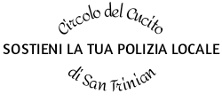
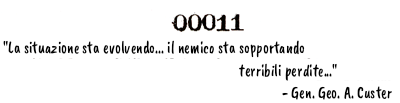

INNO DI BATTAGLIA DELL'ERISTOCRAZIA

di Lord Omar

STROFA

Il mio cervello ha meditato sulla rotazione del Chao;

E' in bilico sul tavolo dove i Capi di Stato Maggiore sono ora

Raccolti a discutere sul lancio della Bomba;

Il Suo Corpo della Mela è forte!

RITORNELLO

Splendida (e sanguinosa) Vecchia Discordia!

Splendida (e sanguinosa) Vecchia Discordia!

Splendida (e sanguinosa) Vecchia Discordia!

Il Suo Corpo della Mela è forte!

STROFA

Ella non fu invitata alla festa che si tenne a "Limbo Peak"\*;

Allora, lanciò una Mela d'Oro, anzichè porgere l'altra guancia!

Oh, essa ruppe la Sacra Coppa del Punch e fece colare il suo nettare;

Il Suo Corpo della Mela è forte!

\* "Limbo peak" si riferisce all'Old Limbo Peak, comunemente chiamato dai Greci "Ol' Limb' Peak"

