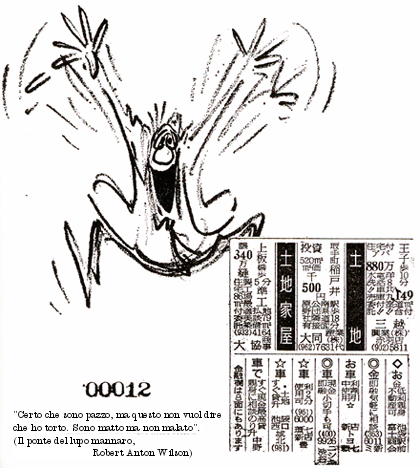

Gente in una Posizione tale da Sapere, SpA

SULLA PREGHIERA

Una volta a Mal-2 fu chiesto da un suo Discepolo se pregasse spesso Eris. Egli rispose con queste parole:

No, noi Erisiani preghiamo raramente. E' troppo pericoloso. Charles Fort ha riportato parecchie evidenze fattuali di gente ignorante che confrontandosi, per esempio, con una siccità, e pertanto pregando ferventemente, ebbero l'intero villaggio spazzato via da una inondazione torrenziale.

