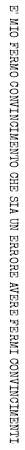
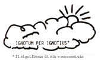

14. Pulisciti il culo con ciò che è scritto\
e sorridi come un cretino a ciò che è detto. \
Trova rifugio col tuo vino nel Nulla \
dietro il Tutto, mentre ti affretti lungo il percorso.

IL SAGGIO VIOLA

HBT; The Book of Predictions, Chap. 19

Il Cielo è giù. L'Inferno è su.

Questo è dimostrato dal fatto

che stelle e pianeti

sono ordinati nei loro

movimenti,

mentre giù sulla terra

ci avviciniamo di più

al caos primigenio.

Ci sono altre quattro

dimostrazioni,

ma le ho dimenticate.

--Josh "Aneto"

Cabala di King Kong

