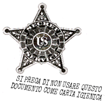

IL RETROSCENA!

La Legge dei Cinque

La legge dei Cinque è uno dei più antichi misteri Erisiani. Esso fu rivelato per la prima volta al buon Lord Omar ed è uno dei più grandi contributi che provenga dal Tempio Nascosto del Gesù Allegro.

La POEE sottoscrive la Legge dei Cinque della setta di Omar. E POEE riconosce anche il Santo 23 (2 +3 = 5) che fu aggiunto dal Vescovo Dr. Mordecai Malignatus, KNS, nella sua setta Discordiana, l'antico Oracolo Illuminato di Baviera.

La legge dei Cinque afferma semplicemente che: TUTTE LE COSE AVVENGONO IN GRUPPI DI CINQUE, O SONO DIVISIBILI PER O MULTIPLE DI CINQUE, O SONO IN QUALCHE MODO DIRETTAMENTE O INDIRETTAMENTE RICONDUCIBILI A 5.

La Legge dei Cinque non sbaglia mai.

Negli Archivi Erisiani c'è un vecchio appunto di Omar per Mal-2: "Noto che la Legge dei Cinque è sempre più manifesta ogni volta che la osservo con maggior attenzione."

I Naga dell'alto Burma dicono che il sole

brilla di giorno perchè, essendo una donna, ha

timore di avventurarsi fuori di notte.
