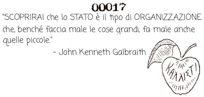

IL MITO DELLA MELA DELLA DISCORDIA

Sembra che Zeus stava preparando un banchetto nuziale per Peleo e Tetis e non voleva invitare Eris a causa della sua reputazione come attaccabrighe.\*

Questo fece infuriare Eris, e perciò Ella preparò una mela di oro puro\*\* sulla quale era iscritto KALLISTI ("alla Più Bella") e il giorno della festa la fece rotolare nella sala del banchetto e quindi se ne andò da sola a gustarsi gioiosamente un hot dog.

A quel punto, tre delle dee invitate, Atena, Era e Afrodite, affermarono, ciascuna, che la mela, considerata l'iscrizione, apparteneva a una di loro. E cominciarono a combattere prendendosi a pugni tra loro e con tutto cio' che avevano intorno.

Alla fine Zeus calmò la situazione e dichiarò che doveva essere scelto un arbitro, il che era un suggerimento ragionevole, e tutti furono d'accordo. Egli le mandò da un pastore di Troia, il cui nome era Paride (Paris) perché la madre si era fatta un sacco di galli e aveva sposato un francese; ma ciascuna delle subdole dee cercò di battere in astuzia le altre arrivando prima e cercando di corromperlo.

Atena gli offrì eroiche vittorie militari, Era una enorme ricchezza, e Afrodite la più bella donna della Terra. Essendo un giovane ragazzo Troiano sano, Paride scelse immediatamente il dono di Afrodite e così lei ebbe la mela e lui la fregatura.
