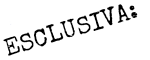
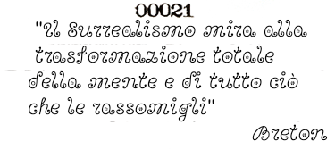

= LA MANO A CINQUE DITA DI ERIS =

Qui è illustrato il simbolo ufficiale del POEE. Può essere questo o qualsiasi dispositivo analogo che rappresenti DUE FRECCE CONTRAPPOSTE CHE CONVERGONO SU UN PUNTO COMUNE. Può essere verticale, orizzontale, o in altro modo, e può essere elaborato o semplificato secondo quanto desiderato.

Il nome esoterico di questo simbolo è LA MANO A CINQUE DITA DI ERIS, comunemente abbreviato in LA MANO.

NOTA: Nella tradizione della magia occidentale, il \/ simboleggia le corna, specialmente le corna di Satana o di bestie diaboliche. La Mano a Cinque Dita di Eris, comunque, non intende essere considerata satanica, dato che le "corna" sono sostenute da un altro insieme, di "corna" invertite. O forse sono zanne di tricheco. Non so cosa siano, per essere sincero.

