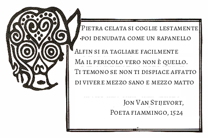
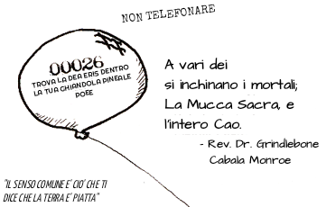

LA AFFERMAZIONE ERISIANA

INNANZI ALLA DEA ERIS, IO (nome o nome sacro), con questo dichiaro me stesso un FRATELLO POEE della LEGIONE DELLA DISCORDIA DINAMICA. AVE AVE AVE AVE AVE ERIS ERIS ERIS ERIS ERIS TUTTI SALUTINO DISCORDIA!

il funzionario POEE che presiede al rito (se presente) risponde:

TUTTI SALUTINO DISCORDIA!

\
\*NdT gioco di parole intraducibile Cow = Mucca Cao = singolare di Caos (sic)\
