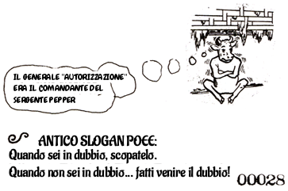

COME AVVIARE UNA CABALA POEE

SENZA AVERE A CHE FARE COL POLIPADRE

Se non riuscite a rintracciare il Polipadre, oppure benché lo abbiate rintracciato non volete avere nulla a che fare con lui, ciò non di meno siete ancora autorizzati a creare la vostra CABALA POEE e fare Cose Pretesche, utilizzando i Principia Discordia come guida. Il Vostro Grado Ufficiale sarà CAPPELLANO POEE della LEGIONE DELLA DISCORDIA DINAMICA, che equivale strettamente a SACERDOTE POE, eccezion fatta per il mancato possesso di un Certificato di Ordinazione. Le parole che stai leggendo valgono per ordinazione.

COME DIVENTARE UN CAPPELLANO POEE

1. Scrivi l'AFFERMAZIONE ERISIANA in cinque copie.

2. Firma con la penna e col naso ciascuna copia.

3. Mandane una al Presidente degli Stati Uniti.

4. Mandane una all'

Ufficio dello Stato della California per l'arredo e l'alloggio.

1021 'D' Street, Sacramento CA 94814

5. Appendine una a un palo del telefono. Nascondine una. Brucia l'ultima. Infine consulta la tua ghiandola pineale.

