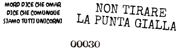
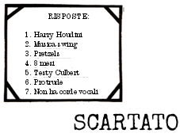

5) ALLORA RIPETI ASSIEME A ME:

(Il Sacerdote conduce l'Iniziato nella recita dell'AFFERMAZIONE ERISIANA). Il Sacerdote continua: PERTANTO IO DICHIARO TE DISCEPOLO POEE (nome), LEGIONARIO DELLA DISCORDIA DINAMICA, AVE ERIS! AVE AVE! AVE SI!

4) Tutti i presenti gioiscono grandemente. Il nuovo Fratello apre una grande damigiana di vino e ne offre a tutti i presenti.

5) La Cerimonia normalmente degenera.

\*Mord dice che Omar dice che siamo comunque tutti unicorni\
Non tirare l'estremità gialla \

3.
E benché Omar avesse richiesto al Raccoglitore del Pattume, \
con parole sia dolci che amare, di restituirgli la scatola di sigari \
contenente le carte indicate dall'Angelo \
come L'Onesto Libro della Verità \
(The Honest Book of Truth, HBT) \
il raccoglitore era sordo al suo richiamo, dicendo soltanto: \
'Sai, è contro le regole".

HBT; Il Libro delle Spiegazioni, Cap. 2

