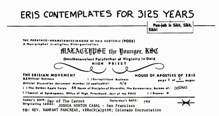

Fratello Ram,

La tua osservazione acuta che ERIS letto al contrario è SIRE [Ndt: "Maitresse"], e aver dedotto da cià che ci sia un simbolismo sessuale in questo fatto, mi ha condotto ad alcune osservazioni per mio conto.

ERIS anagrammato spostando la prima lettera alla fine è RISE [NdT: "crescita"]. E leggendolo dall'interno all'esterno è REIS, che è una moneta Portoghese-Brasiliana benché non più in uso. Da ciò si può concludere che Eris ha usurpato Eros (divinità dell'amore erotico) agli occhi di coloro che che leggono al contrario il che ovviamente rende Eros sorE [NdT: "avvilito"]. Dopo di che Ella apparentemente sgraffignò il Tesoro dell'Olimpo e fuggì in Brasile dove aprì una catena di bordelli (il che sicuramente fu apprezzato dalla popolazione maschile). Lo ipotizzo sulla base del fatto che MADAM si legga allo stesso modo in entrambi i versi. E che sia un termine di grande rispetto, simile a SIRE.

E quindi, grazie alla tua dritta, questo potrebbe essere un indizio del mistero di dove Eris sia andata a farsi fottere per 3125 anni.

CINQUE TONNELLATE DI LINO!

\*

\*Non diffondere
