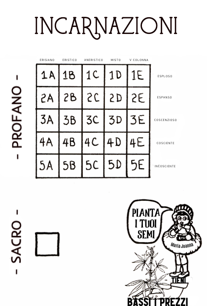

D. "Perché a un picchio non esplode il

cervello?" R. Nessuno l'ha mai spiegato.

"E Dio disse: «Ecco io vi do \
ogni erba che fa seme sulla superficie \
di tutta la terra ...\
questo vi servirà di nutrimento.

-Genesi 1:29
